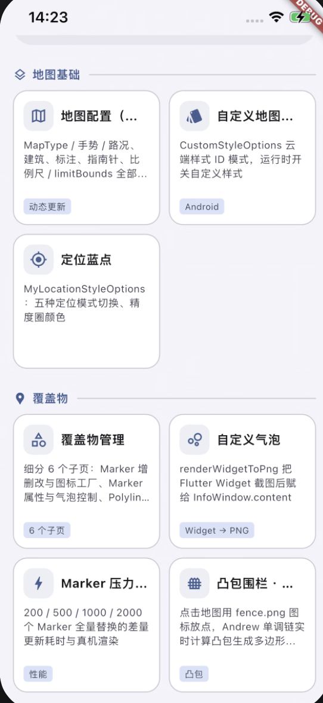

# amap_maps_flutter_qs

[](https://pub.dev/packages/amap_maps_flutter_qs)
[](https://opensource.org/licenses/MIT)

[Simplified Chinese documentation](README_CN.md)

AMap (Gaode Maps) 3D map plugin for Flutter. Single-package architecture (Dart + Android Kotlin + iOS Swift); the API shape follows `google_maps_flutter` and the official `amap_flutter_map` for a smooth migration.

| Demo home | Custom bubble (widget snapshot) |
| --- | --- |
|  |  |

## Features

- **One-step initialization**: `AMapInitializer.init` injects the API key and syncs the privacy-compliance state in one call (both Android and iOS compliance APIs are wrapped).
- **Full map controls**: map type, Chinese/English language, traffic / POI / building UI toggles, zoom controls (`zoomControlsEnabled`, Android) and four gesture switches — all configurable at creation and updatable dynamically.
- **Camera control**: 10 `CameraUpdate` factories plus `moveCamera` / `animateCamera`, zoom range and visible-region bounds.
- **Overlays**: Marker / Polyline / Polygon / Circle with a built-in **diff engine** (only added / removed / changed items are sent to the native side); textured lines, geodesic curves, dashed lines and polygons with holes.
- **Custom info windows**: any Flutter widget -> PNG -> the whole info window (`renderWidgetToPng` + `InfoWindow.content`).
- **Geometry utilities**: `GeometryUtil` computes exclusive-OR regions of circles / polygons on top of clipper2.
- **Map events**: tap / long press / POI / marker tap and drag / info window tap / camera move / map loaded.
- **Screenshot and compliance**: map snapshots and content approval number (for app publishing compliance).
- Both platforms' SDKs are distributed through official channels and the plugin package ships no binaries: Android via mavenCentral, iOS via the CocoaPods trunk.

## Installation

```bash
flutter pub add amap_maps_flutter_qs
```

```yaml
dependencies:
  amap_maps_flutter_qs: ^0.2.2
```

## Quick start

### 1. Get an API key

Create an app and request a key in the [AMap console](https://console.amap.com):

- **Android key**: bound to package name + signing SHA1.
- **iOS key**: bound to BundleID.

### 2. Initialize (required)

> **Privacy compliance**: a real app must show a privacy dialog first and only call `init` with the actual compliance state after the user agrees. The snippet below declares "agreed" for brevity — do not copy it as-is.

```dart
import 'package:amap_maps_flutter_qs/amap_maps_flutter_qs.dart';

Future<void> main() async {
  WidgetsFlutterBinding.ensureInitialized();
  await AMapInitializer.init(
    apiKey: const AMapApiKey(
      androidKey: 'YOUR_ANDROID_KEY',
      iosKey: 'YOUR_IOS_KEY',
    ),
    privacyStatement: const AMapPrivacyStatement(
      hasContains: true, // SDK collects personal information
      hasShow: true,     // privacy policy has been shown to the user
      hasAgree: true,    // user has agreed (set true only after real consent)
    ),
  );
  runApp(const MyApp());
}
```

### 3. Show a map

```dart
import 'package:amap_maps_flutter_qs/amap_maps_flutter_qs.dart';

class MapPage extends StatefulWidget {
  const MapPage({super.key});

  @override
  State<MapPage> createState() => _MapPageState();
}

class _MapPageState extends State<MapPage> {
  AMapController? _controller;

  @override
  Widget build(BuildContext context) {
    return AMapWidget(
      initialCameraPosition: const CameraPosition(
        target: LatLng(39.909187, 116.397451), // Tiananmen, Beijing
        zoom: 12,
      ),
      onMapCreated: (controller) => _controller = controller,
      onTap: (latLng) => print('tap: $latLng'),
      markers: {
        const Marker(
          markerId: MarkerId('tiananmen'),
          position: LatLng(39.909187, 116.397451),
          infoWindow: InfoWindow(title: 'Tiananmen', snippet: 'Dongcheng, Beijing'),
        ),
      },
    );
  }
}
```

## Platform setup

### Android

The plugin pulls in the combined AMap "3D map / location / search" SDK automatically (mavenCentral: `com.amap.api:3dmap-location-search:11.3.100_loc11.3.101_sea9.8.1`); no manual jar / so setup is needed.

Add permissions in `AndroidManifest.xml` (the my-location layer needs location permissions; the map itself only needs network access):

```xml
<uses-permission android:name="android.permission.INTERNET"/>
<uses-permission android:name="android.permission.ACCESS_FINE_LOCATION"/>
<uses-permission android:name="android.permission.ACCESS_COARSE_LOCATION"/>
```

Optional: instead of passing the Android key in Dart, configure it in the Manifest (pass an empty string for `androidKey` in `AMapApiKey` in that case):

```xml
<meta-data
    android:name="com.amap.api.v2.apikey"
    android:value="YOUR_ANDROID_KEY" />
```

### iOS

The plugin pulls in `AMap3DMap ~> 11.2` via CocoaPods automatically. The key is injected through `AMapInitializer.init`; no extra setup is needed. Minimum deployment target is iOS 13.0.

#### Remove `use_frameworks!` from the Podfile

AMap `AMap3DMap` is distributed as a **static framework**, while `use_frameworks!` builds every pod as a dynamic framework — a static library cannot be linked into a dynamic framework, so `pod install` fails with an error that rarely points at the real cause.

If the `ios/Podfile` generated by Flutter contains (or has uncommented) the line below, **delete it or comment it out again**:

```ruby
use_frameworks!   # <- delete this line; it conflicts with the static AMap SDK
```

Also make sure the deployment target is not lower than the plugin requires:

```ruby
platform :ios, '13.0'
```

Other dependencies need no special handling: official Flutter plugins (such as shared_preferences) work fine with static linking, and removing `use_frameworks!` does not affect them.

Example of a correct Podfile:

```ruby
platform :ios, '13.0'

# Note: do not add use_frameworks!

target 'Runner' do
  use_frameworks! :linkage => :static   # optional: if a dependency requires frameworks,
                                        # static linkage stays compatible with AMap
  flutter_install_all_ios_pods File.dirname(File.realpath(__FILE__))
end
```

> If your project has a dependency that really requires `use_frameworks!`, use `use_frameworks! :linkage => :static` instead; static-linked frameworks are also compatible with the AMap SDK.

#### Swift Package Manager

This plugin does **not** support Swift Package Manager yet: no `Package.swift` is provided. When SwiftPM integration is enabled (`flutter build ios --enable-swift-package-manager`), Flutter automatically falls back to CocoaPods for this plugin. **Functionality is unaffected**, but CocoaPods must still be installed on the build machine.

This is an upstream limitation rather than a bug: `AMap3DMap` is only distributed through the CocoaPods trunk, and AMap does not offer an official SPM channel yet. The plugin cannot migrate to SwiftPM while keeping its "no binaries, official distribution channels" policy. SPM support will be added once an official channel is available.

## Permissions

Different capabilities require different native permissions — declare only what you use:

| Capability | Android permission | iOS declaration |
| --- | --- | --- |
| Map display (basic) | `INTERNET` | none |
| My-location layer | `ACCESS_FINE_LOCATION` + `ACCESS_COARSE_LOCATION` + **runtime grant** | `NSLocationWhenInUseUsageDescription` + **runtime grant** |

### Android

Declare in `android/app/src/main/AndroidManifest.xml`:

```xml
<uses-permission android:name="android.permission.INTERNET"/>
<!-- The following two are only needed for the my-location layer -->
<uses-permission android:name="android.permission.ACCESS_FINE_LOCATION"/>
<uses-permission android:name="android.permission.ACCESS_COARSE_LOCATION"/>
```

Location is a dangerous permission and **must be requested at runtime** — declaring it in the Manifest alone will not show a permission dialog. Use [`permission_handler`](https://pub.dev/packages/permission_handler), for example:

```dart
final status = await Permission.locationWhenInUse.request();
if (status.isGranted) {
  // granted; myLocationEnabled can be turned on
}
```

> Note: the `INTERNET` permission is often merged in automatically from the debug manifest, but release builds must declare it explicitly or map tiles will not load.

### iOS

Add a purpose string in `ios/Runner/Info.plist` (write copy that matches your actual use — App Store review checks that it is reasonable):

```xml
<key>NSLocationWhenInUseUsageDescription</key>
<string>Used to show your current location on the map</string>
```

You also need to request the permission at runtime (`CLLocationManager` or `permission_handler`); the system dialog appears the first time a location feature is used.

> The plugin never requests permissions itself and does not crash without authorization — location-related features degrade silently.

## Common features

### Camera control

```dart
// Move / animate to a position
await controller.moveCamera(CameraUpdate.newLatLngZoom(latLng, 15));
await controller.animateCamera(CameraUpdate.newCameraPosition(
  const CameraPosition(target: LatLng(31.2304, 121.4737), zoom: 14, bearing: 45),
));

// Other factories: newLatLng / newLatLngBounds / zoomTo / zoomBy /
// zoomIn / zoomOut / zoomByFocus / scrollBy
```

### Diff-based overlay updates

When Marker / Polyline / Polygon / Circle sets change, the plugin computes a `MarkerUpdates`-style diff internally and sends only added / removed / changed items to the native side:

```dart
setState(() {
  _markers.add(marker); // just mutate the set; no manual diffing needed
});
```

### Custom info windows (widget -> bubble)

```dart
final snapshot = await renderWidgetToPng(context, const MyBubbleCard());
final marker = Marker(
  markerId: const MarkerId('custom_bubble'),
  position: latLng,
  infoWindow: InfoWindow(
    content: BitmapDescriptor.fromBytes(
      snapshot.png,
      width: snapshot.width,
      height: snapshot.height,
    ),
    show: true, // show automatically when added
  ),
);
```

### Geometry (exclusive-OR regions)

```dart
// XOR of two circles: a list of ready-to-render polygons, holes included
final polygons = GeometryUtil.xorCircles(circleA, circleB);
```

### My-location layer

```dart
AMapWidget(
  myLocationEnabled: true,
  myLocationStyleOptions: const MyLocationStyleOptions(
    mode: MyLocationMode.track, // track / follow / rotate and other modes
  ),
)
```

> Location permission must be granted at runtime first; see [Permissions](#permissions).

### Screenshot and approval number

```dart
final png = await controller.takeSnapshot();
final approvalNo = await controller.getContentApprovalNumber(); // required for publishing
```

### Chinese / English map

```dart
AMapWidget(language: MapLanguage.english) // supported at creation and dynamically
```

> SDK limitation: English only applies to the standard map type and is mutually exclusive with custom styles.

## Migrating from amap_flutter_map

The API shape matches the official `amap_flutter_map` 3.0.0, so most cases only need:

1. Replace the dependency: `amap_flutter_map` -> `amap_maps_flutter_qs`.
2. Merge initialization: the official plugin's separate key / compliance calls become a single `AMapInitializer.init`.
3. A few renames: `onPoiTouched` (the former `onPoiTapped` remains as an alias), `limitBounds` (semantically equivalent to `CameraTargetBounds`, which still works).

## Example

The full example app covers nine scenarios: map configuration, overlay management, camera control, geometry utilities, event logs, the my-location layer, screenshots and approval numbers, custom info windows and custom map styles:

```bash
cd example
flutter run \
  --dart-define=AMAP_ANDROID_KEY=<YOUR_ANDROID_KEY> \
  --dart-define=AMAP_IOS_KEY=<YOUR_IOS_KEY>
```

## Related links

- [AMap open platform](https://lbs.amap.com) / [Get a key in the console](https://console.amap.com)
- [AMap Android SDK changelog](https://lbs.amap.com/api/android-sdk/changelog)
- [Issue tracker](https://github.com/Sowaters/amap_maps_flutter_qs/issues)

## License

[MIT](LICENSE)
