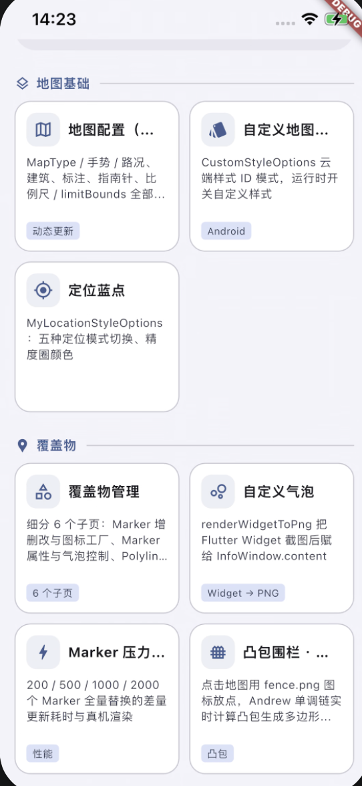
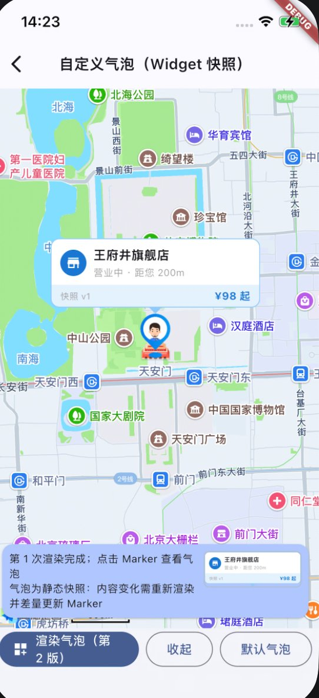

# amap_maps_flutter_qs

[](https://pub.dev/packages/amap_maps_flutter_qs)
[](https://opensource.org/licenses/MIT)

高德地图（AMap / Gaode）3D 地图 Flutter 插件。官方 `amap_flutter_map` 已停止维护，
本插件是其现代继任者：单包架构（Dart + Android Kotlin + iOS Swift），
API 形状对齐 `google_maps_flutter` 与官方插件，便于平滑迁移。

| Demo 首页 | 自定义气泡（Widget 快照） |
| --- | --- |
|  |  |

## 特性

- **一站式初始化**：`AMapInitializer.init` 同时完成 ApiKey 注入与隐私合规同步
  （Android / iOS 双端合规接口均已封装）
- **全量地图能力**：地图类型、中英文切换、路况 / POI / 建筑等 UI 开关、
  四种手势开关，均支持创建时配置与动态更新
- **相机控制**：10 种 `CameraUpdate` 工厂 + `moveCamera` / `animateCamera`、
  缩放范围、可视区域边界限制
- **覆盖物**：Marker / Polyline / Polygon / Circle，内置**差量更新引擎**
  （仅下发增 / 删 / 改三部分），支持纹理线、大地曲线、虚线、孔洞多边形
- **自定义气泡**：任意 Flutter Widget → PNG → 整个气泡窗口
  （`renderWidgetToPng` + `InfoWindow.content`）
- **几何运算**：`GeometryUtil` 基于 clipper2 实现圆 / 多边形互斥区域（XOR）计算
- **地图事件**：点击 / 长按 / POI / Marker 点击与拖拽 / 气泡点击 /
  相机移动 / 加载完成
- **截图与合规**：地图截图、审图号查询（App 上架合规展示）
- 双端 SDK 均经官方渠道分发，插件包零二进制：
  Android 走 mavenCentral，iOS 走 CocoaPods trunk

## 安装

```bash
flutter pub add amap_maps_flutter_qs
```

```yaml
dependencies:
  amap_maps_flutter_qs: ^0.1.0
```

## 快速开始

### 1. 申请 Key

在 [高德开放平台控制台](https://console.amap.com) 创建应用并申请 Key：

- **Android Key**：按「包名 + 签名 SHA1」
- **iOS Key**：按 BundleID

### 2. 初始化（必须）

> ⚠️ **隐私合规**：真实 App 必须先展示隐私弹窗，用户同意后再调用 `init`
> 并传入真实的合规状态。以下示例为演示方便直接声明「已同意」，勿照抄。

```dart
import 'package:amap_maps_flutter_qs/amap_maps_flutter_qs.dart';

Future<void> main() async {
  WidgetsFlutterBinding.ensureInitialized();
  await AMapInitializer.init(
    apiKey: const AMapApiKey(
      androidKey: '你的AndroidKey',
      iosKey: '你的iOSKey',
    ),
    privacyStatement: const AMapPrivacyStatement(
      hasContains: true, // SDK 采集个人信息声明
      hasShow: true,     // 已向用户展示隐私政策
      hasAgree: true,    // 用户已同意（应在真实同意后置 true）
    ),
  );
  runApp(const MyApp());
}
```

### 3. 显示地图

```dart
import 'package:amap_maps_flutter_qs/amap_maps_flutter_qs.dart';

class MapPage extends StatefulWidget {
  const MapPage({super.key});

  @override
  State<MapPage> createState() => _MapPageState();
}

class _MapPageState extends State<MapPage> {
  AMapController? _controller;

  @override
  Widget build(BuildContext context) {
    return AMapWidget(
      initialCameraPosition: const CameraPosition(
        target: LatLng(39.909187, 116.397451), // 北京天安门
        zoom: 12,
      ),
      onMapCreated: (controller) => _controller = controller,
      onTap: (latLng) => print('点击：$latLng'),
      markers: {
        const Marker(
          markerId: MarkerId('tiananmen'),
          position: LatLng(39.909187, 116.397451),
          infoWindow: InfoWindow(title: '天安门', snippet: '北京市东城区'),
        ),
      },
    );
  }
}
```

## 平台配置

### Android

插件自动引入高德「3D 地图 / 定位 / 搜索」三合一 SDK
（mavenCentral：`com.amap.api:3dmap-location-search:11.3.100_loc11.3.101_sea9.8.1`），
无需手动配置 jar / so。

在 `AndroidManifest.xml` 中补充权限（定位蓝点需要定位权限，地图本身只需网络）：

```xml
<uses-permission android:name="android.permission.INTERNET"/>
<uses-permission android:name="android.permission.ACCESS_FINE_LOCATION"/>
<uses-permission android:name="android.permission.ACCESS_COARSE_LOCATION"/>
```

可选：Android Key 也可以不走 Dart 传参，改在 Manifest 配置
（此时 `AMapApiKey` 的 androidKey 传空串即可）：

```xml
<meta-data
    android:name="com.amap.api.v2.apikey"
    android:value="你的AndroidKey" />
```

### iOS

插件通过 CocoaPods 自动引入 `AMap3DMap ~> 11.2`，Key 经
`AMapInitializer.init` 注入，无需额外配置。最低部署版本 iOS 13.0。

#### ⚠️ Podfile 必须移除 use_frameworks!

高德 `AMap3DMap` 以**静态 framework** 分发，而 `use_frameworks!` 会把所有
Pod 打成动态 framework——静态库无法链入动态 framework，`pod install` 会失败，
且报错信息通常不指向真正的原因行，非常难排查。

Flutter 新建工程的 `ios/Podfile` 模板中若存在（或被取消注释）如下一行，
**必须删除或重新注释掉**：

```ruby
use_frameworks!   # ← 删除此行，与高德静态 SDK 冲突
```

同时确保部署平台不低于插件要求：

```ruby
platform :ios, '13.0'
```

无需担心其余依赖：Flutter 官方插件（如 shared_preferences 等）均兼容静态
链接方式，移除 `use_frameworks!` 不影响它们。

正确的 iOS Podfile 关键部分示例：

```ruby
platform :ios, '13.0'

# 注意：不要写 use_frameworks!

target 'Runner' do
  use_frameworks! :linkage => :static   # 可选：如确有依赖需要 frameworks，
                                        # 用静态链接形式，兼容高德 SDK
  flutter_install_all_ios_pods File.dirname(File.realpath(__FILE__))
end
```

> 如果项目确有其他依赖强制要求 `use_frameworks!`，可改用
> `use_frameworks! :linkage => :static`（静态链接的 frameworks），
> 同样兼容高德静态 SDK。

## 权限说明

不同能力所需的原生权限不同，按需声明即可：

| 能力 | Android 权限 | iOS 声明 |
| --- | --- | --- |
| 地图显示（基础） | `INTERNET` | 无需额外声明 |
| 定位蓝点 | `ACCESS_FINE_LOCATION` + `ACCESS_COARSE_LOCATION` + **运行时授权** | `NSLocationWhenInUseUsageDescription` + **运行时授权** |

### Android

在 `android/app/src/main/AndroidManifest.xml` 中声明：

```xml
<uses-permission android:name="android.permission.INTERNET"/>
<!-- 以下两项仅定位蓝点需要 -->
<uses-permission android:name="android.permission.ACCESS_FINE_LOCATION"/>
<uses-permission android:name="android.permission.ACCESS_COARSE_LOCATION"/>
```

定位权限是危险权限，**必须在代码里动态请求**，仅声明 Manifest 不会弹授权框。
可借助 [`permission_handler`](https://pub.dev/packages/permission_handler)：

```dart
final status = await Permission.locationWhenInUse.request();
if (status.isGranted) {
  // 已授权，可开启 myLocationEnabled
}
```

> 注意：发布 release 包时 `INTERNET` 权限常被 debug 清单自动合并，
> 但 release 环境必须自己声明，否则地图瓦片无法加载。

### iOS

在 `ios/Runner/Info.plist` 中声明用途描述（文案请按实际业务填写，
App Store 审核会检查是否描述合理）：

```xml
<key>NSLocationWhenInUseUsageDescription</key>
<string>用于在地图上显示您的当前位置</string>
```

同样需要在代码中动态请求（`CLLocationManager` 或 `permission_handler`），
首次调用定位相关能力时系统会弹出授权框。

> 插件自身不申请任何权限，也不会在未授权时崩溃——未授权时定位蓝点
> 相关功能静默降级。

## 常用能力

### 相机控制

```dart
// 移动 / 动画到指定位置
await controller.moveCamera(CameraUpdate.newLatLngZoom(latLng, 15));
await controller.animateCamera(CameraUpdate.newCameraPosition(
  const CameraPosition(target: LatLng(31.2304, 121.4737), zoom: 14, bearing: 45),
));

// 其他工厂：newLatLng / newLatLngBounds / zoomTo / zoomBy /
// zoomIn / zoomOut / zoomByFocus / scrollBy
```

### 差量更新覆盖物

Marker / Polyline / Polygon / Circle 集合变更时，插件内部通过
`MarkerUpdates` 等 diff 只把增 / 删 / 改三部分下发给原生端：

```dart
setState(() {
  _markers.add(marker); // 直接改集合即可，无需手动计算差异
});
```

### 自定义气泡（Widget → 气泡）

```dart
final snapshot = await renderWidgetToPng(context, const MyBubbleCard());
final marker = Marker(
  markerId: const MarkerId('custom_bubble'),
  position: latLng,
  infoWindow: InfoWindow(
    content: BitmapDescriptor.fromBytes(
      snapshot.png,
      width: snapshot.width,
      height: snapshot.height,
    ),
    show: true, // 添加时自动弹出
  ),
);
```

### 几何运算（互斥区域）

```dart
// 两个圆的 XOR 区域：返回含孔洞、可直接上图的 Polygon 列表
final polygons = GeometryUtil.xorCircles(circleA, circleB);
```

### 定位蓝点

```dart
AMapWidget(
  myLocationEnabled: true,
  myLocationStyleOptions: const MyLocationStyleOptions(
    mode: MyLocationMode.track, // 定位 / 跟随 / 旋转等五种模式
  ),
)
```

> 需先取得定位权限并完成运行时授权，详见上文「[权限说明](#权限说明)」。

### 截图与审图号

```dart
final png = await controller.takeSnapshot();
final approvalNo = await controller.getContentApprovalNumber(); // 上架合规需展示
```

### 中英文地图

```dart
AMapWidget(language: MapLanguage.english) // 支持创建时与动态切换
```

> SDK 限制：英文仅标准地图类型生效，且与自定义样式互斥。

## 从 amap_flutter_map 迁移

API 形状与官方 `amap_flutter_map` 3.0.0 对齐，绝大多数场景只需：

1. 替换依赖：`amap_flutter_map` → `amap_maps_flutter_qs`
2. 合并初始化：官方分散的 Key / 合规调用统一为 `AMapInitializer.init`
3. 个别更名：如 `onPoiTouched`（原 `onPoiTapped` 仍保留别名）、
   `limitBounds`（原 `CameraTargetBounds` 语义等价可用）

## Example

完整示例 App 覆盖地图配置、覆盖物管理、相机控制、几何运算、事件日志、
定位蓝点、截图与审图号、自定义气泡、自定义地图样式九大场景：

```bash
cd example
flutter run \
  --dart-define=AMAP_ANDROID_KEY=<你的AndroidKey> \
  --dart-define=AMAP_IOS_KEY=<你的iOSKey>
```

## 相关链接

- [高德开放平台](https://lbs.amap.com) / [控制台申请 Key](https://console.amap.com)
- [高德 Android SDK 更新日志](https://lbs.amap.com/api/android-sdk/changelog)
- [问题反馈](https://github.com/Sowaters/amap_maps_flutter_qs/issues)

## License

[MIT](LICENSE)
